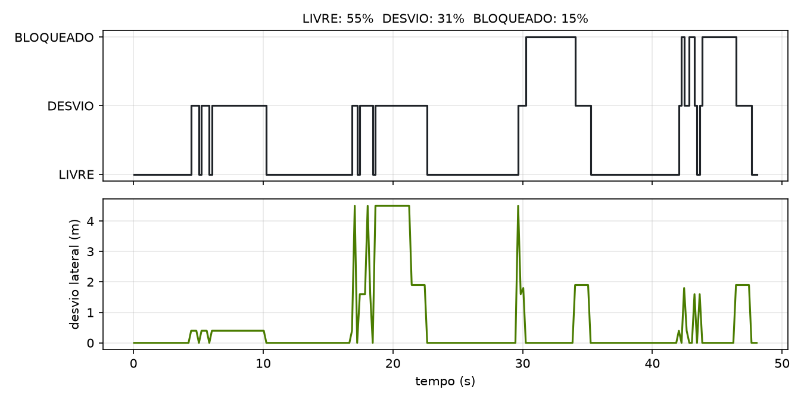

# VA 2026/2027 · Grupo 00 · <tema do projeto>

<!-- Uma frase: o que este repositório faz. Ex.: "Perceção frontal com LiDAR 2D Sick LMS151
no ATLASCAR2: deteção de obstáculos, espaço livre e planeamento local." -->

Do some change.
Another change.


| | |
|---|---|
| **Sensor** | <modelo, ligação (Ethernet / USB / série), frequência> |
| **Posição no carro** | <frame_id, x y z (m) e orientação em relação ao base_link> |
| **Driver ROS 2** | <pacote, p. ex. `ros-jazzy-sick-scan-xd`> |
| **Saídas** | `/gNN/grelha_local`, `/gNN/caminho_local`, `/gNN/estado`, <outras> |
| **Equipa** | <nome (nº mec.)>, <nome (nº mec.)> |

## Arquitetura

<!-- Diagrama dos nós e tópicos (pode ser uma imagem em docs/img/). -->

| Serviço (compose) | Nó | Subscreve | Publica |
|---|---|---|---|
| `driver` | <driver do sensor> | | `<tópico standard do sensor>` |
| `percecao` | `scan_to_grid` | `/scan`, `/tf_static` | `/g00/grelha_local` (nav_msgs/OccupancyGrid) |
| `planeador` | `local_astar` | `/g00/grelha_local` | `/g00/caminho_local` (nav_msgs/Path), `/g00/estado` (std_msgs/String), `/g00/zona_proibida` |

## Como correr

Requisitos: Docker (Ubuntu 24.04 com Docker Engine; Windows com Docker Desktop, sem sensores).

```bash
git clone <url-deste-repositório> && cd <pasta>
docker compose build
docker compose --profile simulado up                 # sem sensor: LiDAR simulado
BAG=<pasta_em_data> docker compose --profile reproduzir up   # com um bag gravado
docker compose --profile sensor up                   # com o sensor ligado (Linux)
```

Windows (PowerShell): `$env:COMPOSE_FILE = "compose.windows.yaml"` antes dos comandos acima.
Visualização: `--profile foxglove` e, no Foxglove, `ws://localhost:8765`.

Parâmetros que dependem do carro (IP do sensor, porta, dispositivo): <listar aqui>.

## Dados

| Bag | Data | Percurso | Duração | Tópicos |
|---|---|---|---|---|
| `g00_<sensor>_<data>_<percurso>` | | <mapa em docs/img/> | | |

Os bags não estão no GitHub (ficam no SSD); ver <onde estão>.

## Resultados

<!-- Figuras geradas com:  python tools/figura_bag.py data/<bag> --grupo g00 --gif docs/img/demo.gif -->




<!-- Métricas: frequência dos tópicos, tempo do A*, % do tempo em LIVRE/DESVIO/BLOQUEADO,
     deteções corretas / falsas, etc. -->

## Limitações e trabalho futuro

<!-- O que não funciona, em que condições, e o que falta para a parte 2. -->
