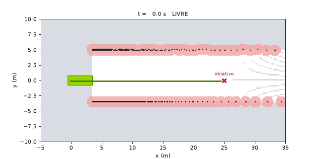
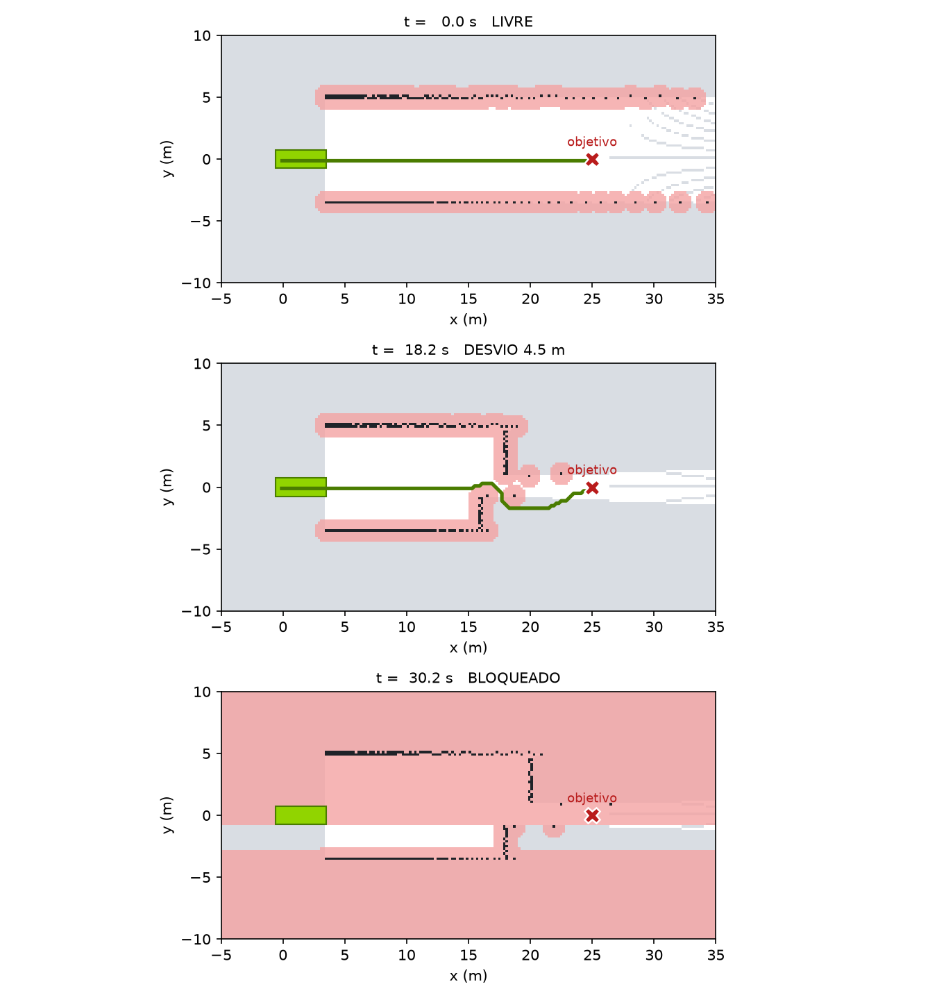

# VA 2026/2027 · Group 03 · RoadSense (project 8)

<!-- One sentence: what this repository does. E.g.: "Front perception with a 2D Sick LMS151 LiDAR
on the ATLASCAR2: obstacle detection, free space and local planning." -->




| | |
|---|---|
| **Sensor** | 4-beam LiDAR |
| **Position on the car** | TODO: |
| **ROS 2 driver** | TODO: |
| **Outputs** | The group's own topics; `/g03/grelha_local` (nav_msgs/OccupancyGrid in `base_link`, 0.2 m cells, x from -5 to 35 m, y from -10 to 10 m; -1 unknown, 0 free, 100 occupied) |
| **Team** | TODO: |

## Architecture

<!-- Diagram of nodes and topics (can be an image in docs/img/). -->

| Compose service | Node | Subscribes | Publishes |
|---|---|---|---|
| `driver` | <sensor driver> | | `<standard sensor topic>` |
| `percecao` | `scan_to_grid` | `/scan`, `/tf_static` | `/g03/grelha_local` (nav_msgs/OccupancyGrid) |
| `planeador` | `local_astar` | `/g03/grelha_local` | `/g03/caminho_local` (nav_msgs/Path), `/g03/estado` (std_msgs/String), `/g03/zona_proibida` |

## How to run

Requirements: Docker (Ubuntu 24.04 with Docker Engine; Windows with Docker Desktop, no sensors).

```bash
git clone <repo-url> && cd <folder>
docker compose build
docker compose --profile simulado up                 # no sensor: simulated LiDAR
BAG=<folder_in_data> docker compose --profile reproduzir up   # with a recorded bag
docker compose --profile sensor up                   # with the sensor connected (Linux)
```

Windows (PowerShell): `$env:COMPOSE_FILE = "compose.windows.yaml"` before the commands above.
Visualization: `--profile foxglove` and, in Foxglove, `ws://localhost:8765`.

Car-dependent parameters (sensor IP, port, device): <list here>.

## Data

| Bag | Date | Route | Duration | Topics |
|---|---|---|---|---|
| `g03_<sensor>_<date>_<route>` | | <map in docs/img/> | | |

Bags are not on GitHub (they stay on the SSD); see <where they are>.

## Results

<!-- Figures generated with:  python tools/figura_bag.py data/<bag> --grupo g03 --gif docs/img/demo.gif -->




<!-- Metrics: topic frequencies, A* time, % of time in LIVRE/DESVIO/BLOQUEADO,
     correct / false detections, etc. -->

## Limitations and future work

<!-- What does not work, under which conditions, and what is still missing for part 2. -->
